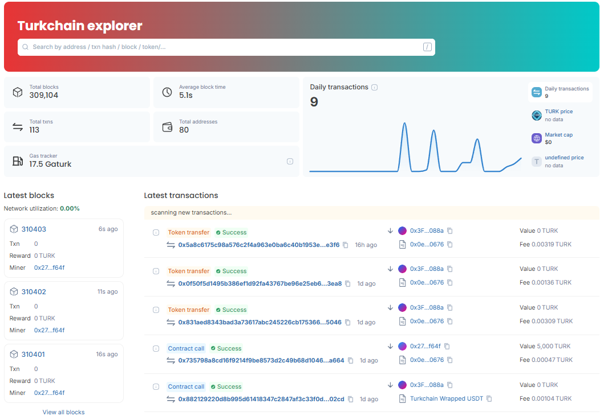

# Welcome to TurkScan®

TurkScan® is the explorer for Turkchain® Mainnet. Inspect blocks, transactions, addresses, tokens and verified contract source, or integrate with the public explorer APIs.

<figure><figcaption>TurkScan®</figcaption></figure>

| Setting | Value |
| --- | --- |
| Network | Turkchain® Mainnet |
| Chain ID (decimal) | `1919` |
| EVM chain ID (hex) | `0x77f` |
| Native currency | TURK |
| Decimals | `18` |
| HTTPS JSON-RPC | `https://rpc.turkscan.com` |
| WebSocket | `wss://evm-ws.turkscan.com` |
| Explorer | `https://turkscan.com` |

`eth_chainId` returned `0x77f` during the 14 November 2026 audit. Wallet network names are display labels; the chain ID determines the execution network.

Start with [Connect to Turkchain](getting-started/connect-to-turkchain.md), [Using the Explorer](getting-started/using-turkscan-explorer.md) or the [API Reference](api-documentation/introduction.md).

Developers can use [RPC Integration](developers/rpc-integration.md), [Viem](developers/viem-integration.md), [Ethers.js](developers/ethers-integration.md) and [Contract Verification](smart-contracts/contract-verification.md). The [Cross-Chain Status](cross-chain/overview.md) distinguishes registry evidence from verified transfer routes and roadmap work.

These documentation sources are maintained in [Turkchain1919/doc](https://github.com/Turkchain1919/doc) and published by the existing GitBook site at `https://doc.turkscan.com`. TurkScan uses Blockscout-based infrastructure; [sources and attribution](reference/sources-and-attribution.md) explain the technical provenance.
